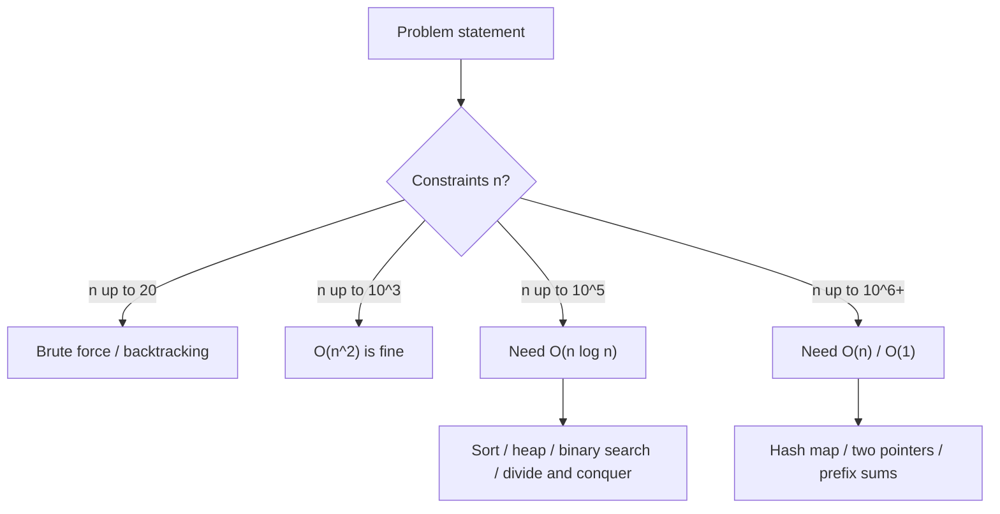
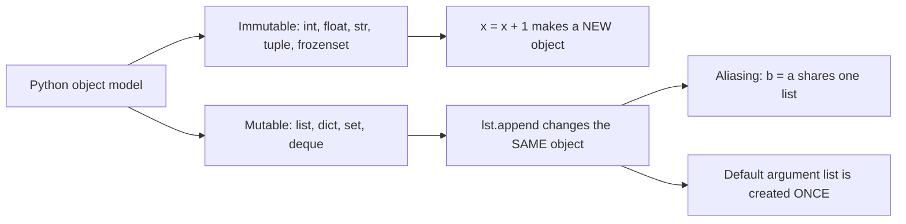
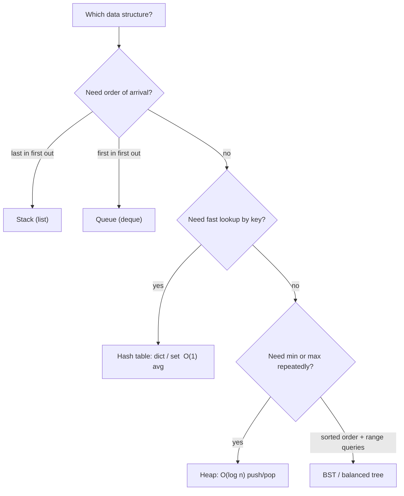
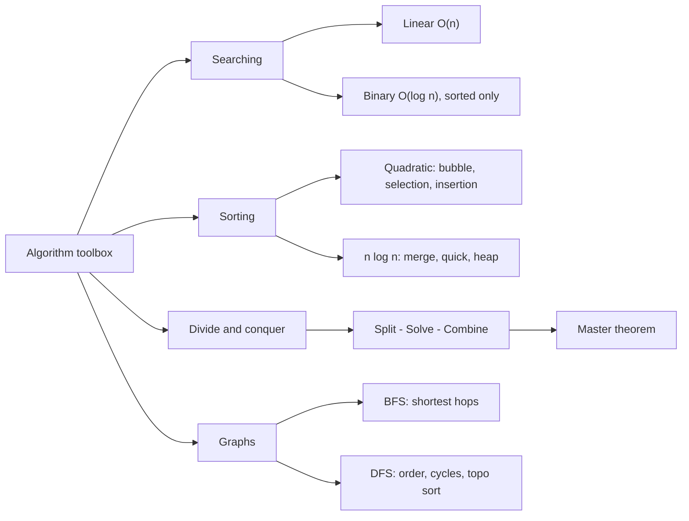
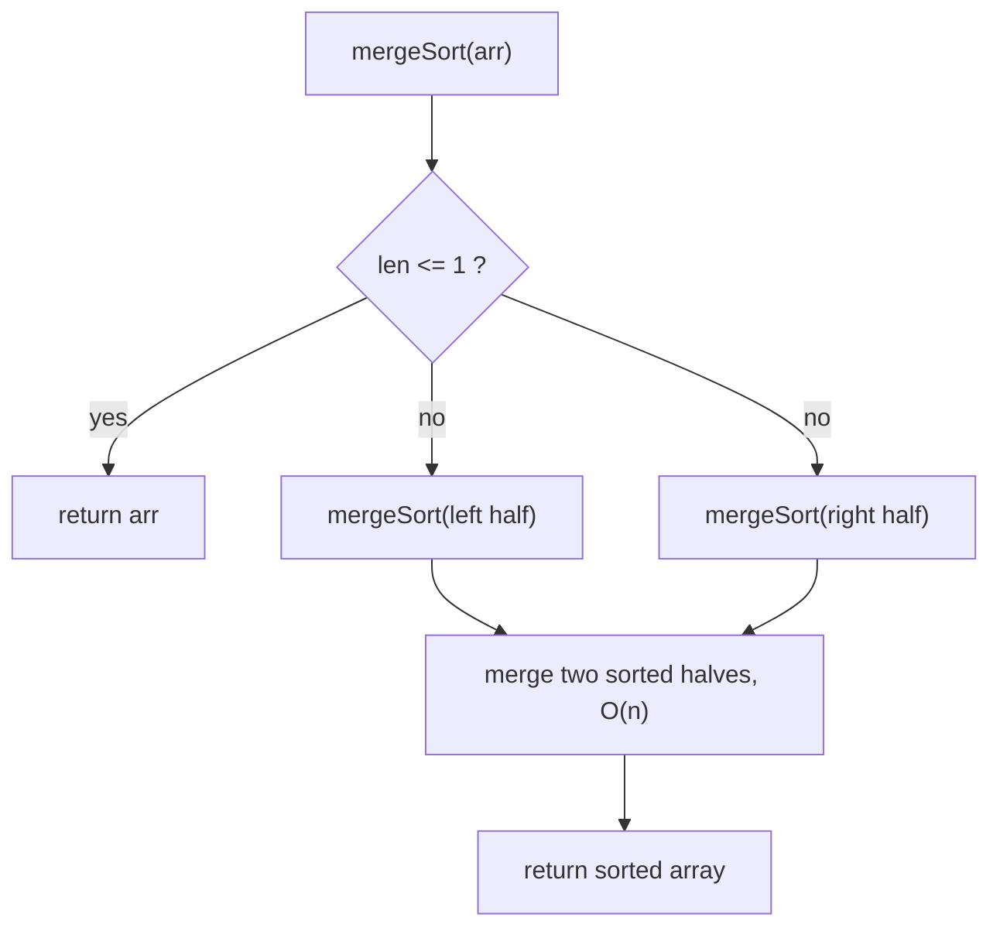
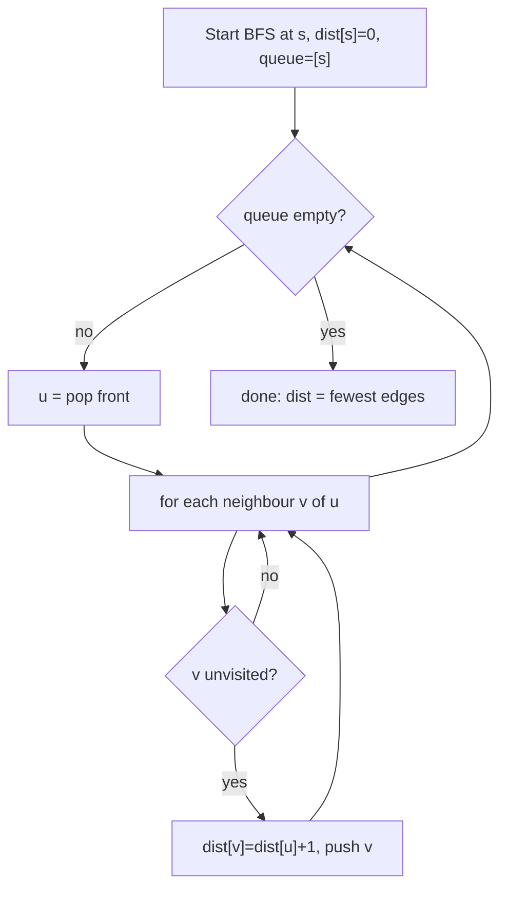
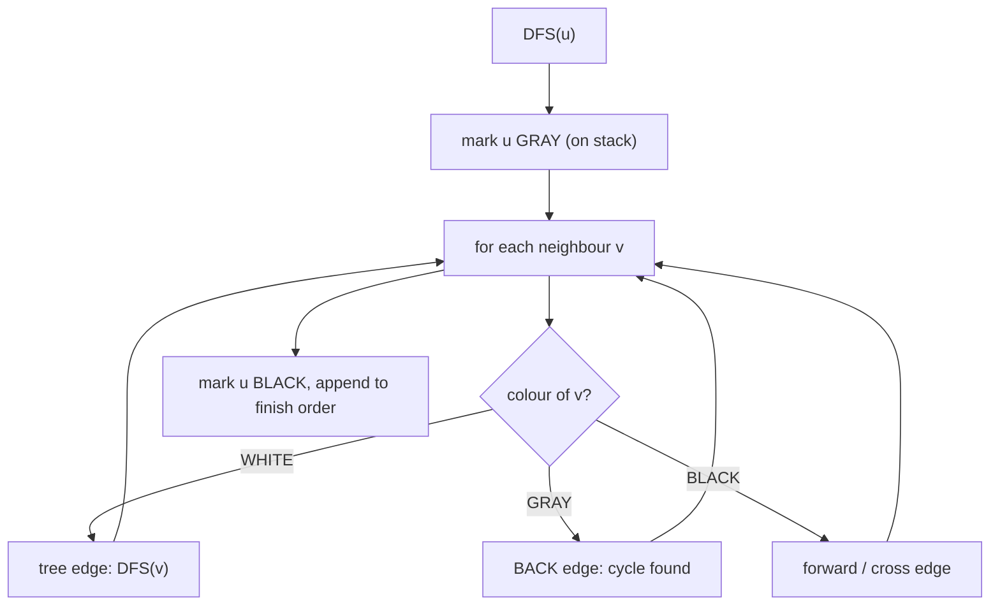
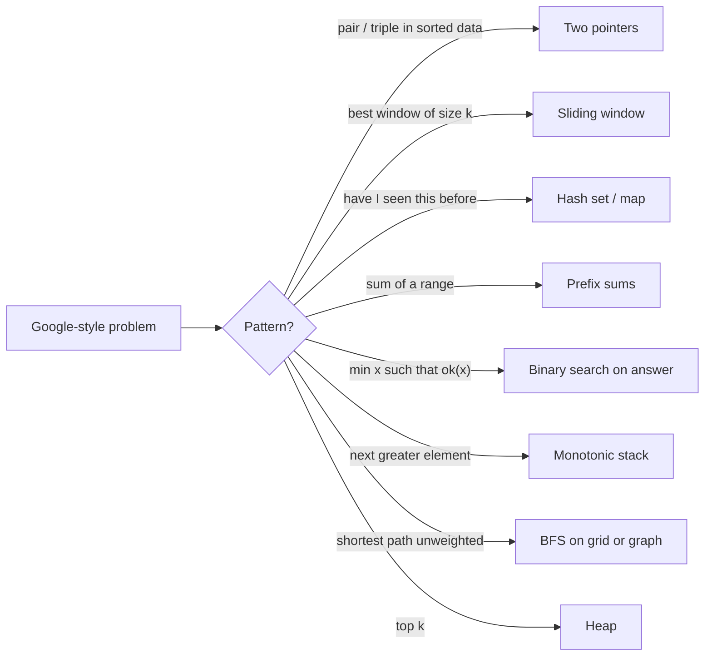
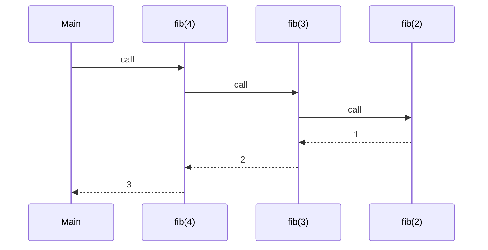

# Mermaid sources for the DSA Deep Edition

Paste any block into https://mermaid.live or render with `mmdc -i x.mmd -o x.pdf --pdfFit`.

## d1

## d2

## d3

## d4

## d5

## d6

## d7

## d8

## d9

